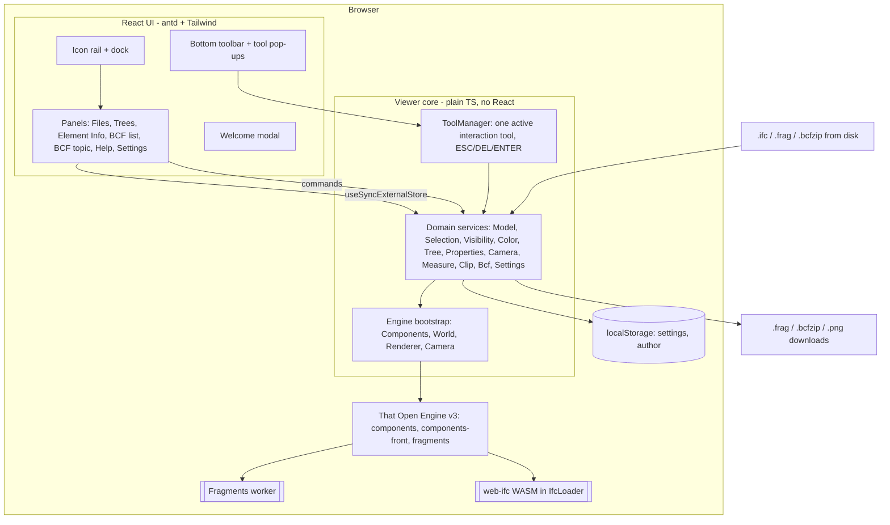
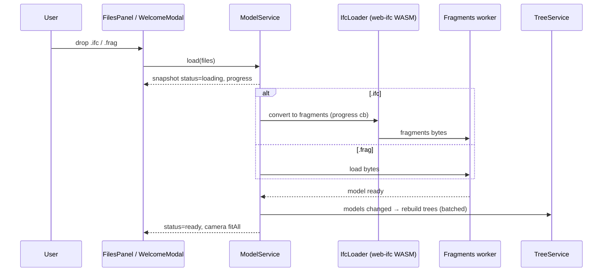
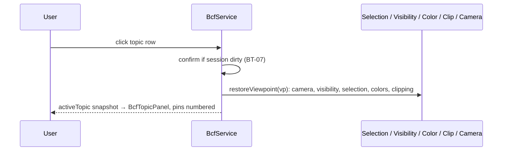

# System Design & Architecture

Requirements: [`../requirements/feature-bim-viewer.md`](../requirements/feature-bim-viewer.md). Phase 1 = every P0 + P1 requirement (exact parity with viewer.crais.io), English-only, no contact form, no backend.

## Architecture Overview

A static, client-only single-page app. Nothing leaves the browser (FM-05).



**Layers (one-way dependencies):** `ui/` → `core/` → That Open / three.js. `core/` never imports React or antd, so it can be unit-tested headless and reused.

### Technology stack

| Concern | Choice | Version (2026-10-14) | Why |
|---|---|---|---|
| 3D / IFC | `@thatopen/components`, `@thatopen/components-front`, `@thatopen/fragments` on `three` | 3.4.x / 0.186 | MIT. Includes `.frag` format and worker streaming, IfcLoader (web-ifc), BCFTopics (2.1 + 3.0), Length/Area/Volume measurement, Clipper + ClipStyler, Hider, Classifier, Highlighter, Outliner, Marker. Appears to be what the reference uses. |
| UI | React + Vite + TypeScript | React 19, Vite 8 | Same as the reference. Engine state is bridged with `useSyncExternalStore`. |
| Components | **Ant Design** + **Tailwind CSS** | antd 6, Tailwind 4 | antd: virtualized `Tree`, `Table` (filters, column settings, row selection), `DatePicker`, `ColorPicker`, `Form`, `Tabs`, `Collapse`, `Tooltip`, `Popover`, `Modal`, `Upload.Dragger`, light/dark `theme.algorithm`. Tailwind is for layout and spacing only. |
| BCF zip | handled by BCFTopics, plus `fflate` for the pin sidecar | — | See D4. |
| Tests | Vitest (core, BCF round-trip) + Playwright (UI flows, WebGL) | Vitest 5, Playwright 1.64 | |

**antd + Tailwind coexistence:** Tailwind v4 is imported **without preflight**: `@import "tailwindcss/theme"` and `@import "tailwindcss/utilities"`, but not `preflight`. antd is wrapped in `<StyleProvider layer>`. CSS `@layer` order is `theme, antd, utilities`, so utilities win over antd and Tailwind resets don't break antd. Theme tokens (colors, radius) are defined once in `ui/theme.ts` and fed into both antd `ConfigProvider` and Tailwind `@theme`.

## Data Models

```ts
// Element identity across federated models: That Open's ModelIdMap.
type ModelIdMap = Record<string /*modelId*/, Set<number /*localId*/>>;

interface LoadedModel {
  id: string;            // modelId (file name without extension, de-duplicated)
  fileName: string;
  source: 'ifc' | 'frag' | 'example';
  status: 'loading' | 'ready' | 'error';
  progress: number;      // 0..1
  error?: string;
}

type ToolId =
  | 'select' | 'marquee'
  | 'length-free' | 'length-edge' | 'area-free' | 'area-rect' | 'area-face' | 'volume'
  | 'clip-plane' | 'clip-box' | 'view-from-plane'
  | 'bcf-pin' | 'color-paint';

type NavMode = 'orbit' | 'fly' | 'drone';
type Projection = 'perspective' | 'orthographic';
type ColorMode = 'original' | 'white';            // custom colors are layered on top of both

interface TreeNode {                               // Relations / Types / Storeys
  key: string; title: string; ifcClass?: string;
  items: ModelIdMap;                               // every element under this node
  children?: TreeNode[];
}

// BCF: That Open's Topic / Comment / Viewpoint objects are the storage model.
// Our only additions:
interface TopicPin { topicGuid: string; viewpointGuid: string; position: [number, number, number]; number: number; }
interface TopicSession {                           // BT-07 edit session
  topicGuid: string | 'new';
  draft: TopicFields;                              // title, description, assignee, due, status, priority, type, stage, labels
  addedComments: string[];                         // comment guids that can be edited/removed until save
  dirty: boolean;
}
interface Settings {
  theme: 'light' | 'dark';
  outlines: boolean; depthShadows: boolean; antialiasing: boolean; fixMissingFaces: boolean;
  author?: string; rememberAuthor: boolean;
}
```

**Viewpoint = full view state.** Capture or restore covers: camera (position, direction, up, projection, field of view or view-to-world scale), selection, visibility (default visibility plus exceptions), custom colors (BCF `Coloring`), clipping planes (BCF `ClippingPlanes`) and an optional pin. All of these come from or go to the services. No viewpoint state is duplicated in React.

## API Design (internal)

There's no external API in Phase 1. Every core service follows one shape:

```ts
interface Store<T> { getSnapshot(): T; subscribe(cb: () => void): () => void; }

// ui hook: const sel = useStore(core.selection);   // = useSyncExternalStore(s.subscribe, s.getSnapshot)
```

Services expose **commands** (verbs) plus one **snapshot** (immutable, replaced on change). Callers never receive three.js or That Open objects.

| Service | Snapshot | Key commands | Covers |
|---|---|---|---|
| `ModelService` | `LoadedModel[]` | `load(files)`, `loadExample()`, `unload(id)`, `unloadAll()`, `downloadFrag(id)` | FM-01…06, WL-04 |
| `TreeService` | `{relations, types, storeys}: TreeNode[]` (built once per model change, cached) | `search(q)`, `showOpenings(b)`, `showSpaces(b)` | MT-01…03, 08, 09 |
| `SelectionService` | `{items: ModelIdMap, count}` | `set(map)`, `add`, `toggle`, `clear()`, `pick(ray, mods)`, `marquee(rect, crossing)` | SE-01…03, MT-06 |
| `VisibilityService` | `{hidden: ModelIdMap, isolated: boolean}` | `hide(sel)`, `show(sel)`, `isolate(sel)`, `showAll()`, `fitAll()`, `fitSelection()`, `resetAll()` | VI-01…03, MT-07, NV-04 |
| `ColorService` | `{mode, custom: Map<hex, ModelIdMap>}` | `setMode`, `paint(map, hex)`, `erase(map)`, `clearCustom()` | CO-01…05, MT-05 |
| `PropertiesService` | — (async query) | `get(modelId, localId) → {identity, psets, qtos, relations, materials}` | EI-01…03 |
| `CameraService` | `{nav, projection}` | `setNav`, `setProjection`, `topView()`, `bottomView()`, `alignToFace(hit)` | NV-01…03, CA-01…03 |
| `MeasureService` | `{count, visible}` | `deleteAll()`, `setVisible(b)`, `deleteHovered()` (tools drive creation) | ME-01…08 |
| `ClipService` | `{planes: number, enabled, helpersVisible}` | `addPlaneOnFace(hit)`, `boxAround(sel)`, `setEnabled`, `setHelpersVisible`, `deleteAll()` (cap 10) | CL-01…06 |
| `BcfService` | `{topics, filteredIds, activeTopic, session, pinsVisible, pinColorBy}` | `import(file)`, `export(ids, version)`, `newTopic(withPin?)`, `startEdit`, `saveSession`, `cancelSession`, `addComment`, `captureViewpoint`, `restoreViewpoint`, `placePin`, `replaceSnapshot(file)`, `saveSketch(png)`, `deleteTopics(ids)`, `setAuthor` | BM-01…08, BT-01…08 |
| `SettingsService` | `Settings` | `update(partial)` (persists to localStorage, applies to renderer) | ST-01, 03, 05 |
| `ToolManager` | `{active: ToolId}` | `activate(id)`, `exit()`; owns pointer and keyboard routing | LY-04, all "ESC/DEL/ENTER" rules |

`core/index.ts` exports `createViewer(container: HTMLElement): Viewer`, which returns all services plus `dispose()`. React gets it through one context.

## Component Breakdown

```
src/
  core/                       # no React
    engine.ts                 # Components, SimpleWorld, PostproductionRenderer, OrthoPerspectiveCamera, FragmentsManager(worker), IfcLoader
    store.ts                  # Store<T> helper (~20 lines)
    services/*.ts             # one file per service above
    tools/*.ts                # one class per ToolId family: SelectTool, MeasureTool, ClipTool, PinTool, PaintTool
    bcf/pins.ts               # pins.json sidecar read/write (fflate)
  ui/
    App.tsx                   # ConfigProvider(theme) + layout grid
    theme.ts                  # shared tokens → antd + Tailwind
    strings.ts                # all English UI text in one module (ST-02)
    layout/Rail.tsx, Dock.tsx, Toolbar.tsx, ToolGroup.tsx
    panels/FilesPanel, TreesPanel, ElementInfoPanel, BcfListPanel, BcfTopicPanel, HelpPanel, SettingsPanel
    welcome/WelcomeModal.tsx
    bcf/SnapshotViewer.tsx, SketchCanvas.tsx, ColumnSettings.tsx, PinSettings.tsx
public/examples/              # sample IFCs (open licence) + demo.bcfzip
```

**Key UI flows**





## Design Decisions

| # | Decision | Alternatives considered | Rationale |
|---|---|---|---|
| D1 | That Open Engine v3 | raw three.js + web-ifc; xeokit | Provides `.frag`, workers, BCF 2.1/3.0 and every measure/clip tool already. xeokit is AGPL and has no `.frag` support. Building on raw three.js would add months. |
| D2 | React + Vite + TS | @thatopen/ui web components; Vue | Matches the reference. antd covers the heavy UI parts (tree, table, pickers). |
| D3 | **The engine is the source of truth.** Services own state; React reads it through `useSyncExternalStore`. | Zustand mirror; Redux | Avoids keeping two copies of selection, visibility and colors in sync, which is a common bug source with 100k+ elements. Adds no state library. |
| D4 | BCF via **That Open `BCFTopics`** (`load`, `export`, `config.version = "2.1" \| "3"`). **Pins** go in a `pins.json` sidecar inside the `.bcfzip`. Sketches replace the snapshot PNG. | own parser (fflate + fast-xml-parser); pins kept for the session only | Least code. Other tools ignore the extra file, and our app round-trips it. **Spike S1 must prove round-trip fidelity first.** If it fails, switch to our own parser behind the same `BcfService` API. |
| D5 | Ant Design 6 + Tailwind 4 (utilities only, no preflight, CSS layers) | shadcn/ui; Mantine | User choice. The CSS-layer setup prevents style conflicts. |
| D6 | Tools are a **single active tool** behind `ToolManager` | each panel/toolbar wiring its own listeners | Matches the reference (one highlighted tool). ESC, DEL and ENTER handling lives in one place. |
| D7 | Example = openly licensed sample IFCs (ARC/STR/MEP where available) + our own `demo.bcfzip` (19 topics); currently the VTT BIM4LCA office (CC BY-SA 4.0) as static assets | your own models; no example | Keeps the one-click demo without reusing crais's files. Licences are recorded in `public/examples/LICENSES.md`. |
| D8 | English strings in `ui/strings.ts`, no i18n library | i18next now | YAGNI. Moving to i18next later is a mechanical change. |

## Requirements Coverage

| Area | Design element | Notes |
|---|---|---|
| LY-01…05 | `Rail`, `Dock` (antd `Layout.Sider`-like, floating BCF Topic card), `Toolbar` + `ToolGroup` (antd `Popover` on hover, `Tooltip`) | Contact icon omitted (HC-02 deferred) |
| WL-01…04 | `WelcomeModal` (`Upload.Dragger`), `ModelService.loadExample()` | |
| FM-01…06 | `ModelService`, IfcLoader + Fragments worker, `FragmentsModel.getBuffer()` for `.frag` download | |
| MT-01…09 | `TreeService` + antd `Tree` (`virtual`, `height`) with custom title (swatch + eye) | Storeys grouped across models into ELEVATIONGROUP levels (elevations < 1 m apart), one row per model storey |
| EI-01…03 | `PropertiesService` (fragments item data + relations), antd `Tabs`/`Collapse`/`Descriptions` | Quantities tab disabled when empty |
| SE-01…03 | `SelectTool`, `MarqueeTool` (screen rect → frustum selection), Highlighter/Hoverer | Window vs crossing selection based on drag direction |
| NV-01…04 | `CameraService` → OrthoPerspectiveCamera modes (Orbit, FirstPerson for Fly, Plan-style screen pan for Drone) | Spike S3 |
| CA-01…03 | `CameraService` | |
| VI-01…03 | `VisibilityService` (Hider), `resetAll()` = visibility + tools + camera + color mode | |
| CO-01…05 | `ColorService` (fragments highlight/color layers), `PaintTool` + antd `ColorPicker` | Custom colors written to BCF `Coloring` |
| ME-01…08 | `MeasureTool` → Length/Area/Volume measurement components with snapping | Metric units |
| CL-01…06 | `ClipTool`, `ClipService` → Clipper (max 10 planes), box gizmo, ClipStyler caps | |
| BM-01…08 | `BcfService` + `BcfListPanel` (antd `Table`: row selection, column filters, column settings, search) | |
| BT-01…08 | `BcfService` session + `BcfTopicPanel` (antd `Form`, `DatePicker`, `Select mode="tags"`), `PinTool`, `SnapshotViewer`, `SketchCanvas` (2D canvas over the image) | |
| ST-01, 03 | `SettingsService` → antd `theme.darkAlgorithm` + Tailwind `dark` class; renderer flags (outlines, AO, AA, double-sided) | ST-02: English-only. ST-04 deferred (A3) |
| HC-01 | `HelpPanel` driven by a static `helpContent` array in `strings.ts` | HC-02/03 deferred |

## Non-Functional Requirements

- **Performance:** IFC conversion and fragment streaming run off the main thread. Trees are built once per model change and rendered virtualized. Snapshots are immutable, so React re-renders only what changed. Targets come from the requirements: first render of the example in under 5 s, at least 30 FPS orbiting 200 MB, and `.frag` reloads at least 3× faster than IFC.
- **Memory:** `unload()` disposes geometry, materials and the worker model. A Playwright test loads and unloads 5 times and checks heap growth.
- **Privacy/Security:** no `fetch` or XHR other than same-origin static assets (WASM, worker, examples). A CSP header sets `connect-src 'self'`. An E2E test asserts there are no off-origin requests (requirements success criterion). Imported BCF XML is parsed as data only. Snapshot and sketch images are shown as `blob:` URLs, never as HTML.
- **Reliability:** if a worker crashes, the affected models are marked `error` and the user sees a retry option. Invalid IFC or BCF shows a readable message (FM-06, BM-07).
- **Browsers:** latest 2 versions of Chrome, Edge, Firefox and Safari; WebGL2 required, with a clear message if it's unavailable.

## Spikes (do first in implementation)

- **S1 — BCF fidelity:** import → export round-trips for 2.1→2.1 and 3.0→3.0 with sample files (BCF-XML test suite), plus 2.1↔3.0 conversion, checking every field, snapshot, coloring and clipping. Also check that the `pins.json` sidecar doesn't break other readers. *Exit: pass, or switch BcfService internals to our own parser.*
- **S2 — Tools:** confirm components-front supports length **edge** mode, area **rectangle/face**, **volume** by element and snapping. Write the missing modes on top of the raycaster.
- **S3 — Navigation:** map Fly and Drone to OrthoPerspectiveCamera modes and match the reference's keyboard and mouse behaviour.
- **S4 — Example assets:** find sample IFCs with an open licence that covers redistribution.

## Assumptions (accepted unless you say otherwise)

- **A1** Loaded models, BCF topics and measurements are **in memory only** and are lost on reload. Only `Settings` (theme, appearance, author if remembered) is persisted in localStorage.
- **A2** Desktop only (≥ 1024 px), mouse and keyboard; touch isn't supported in Phase 1.
- **A3** **Decided:** no analytics in Phase 1 → no cookie banner; ST-04 deferred to P2.
- **A4** Deploy as a static site (host chosen in the deployment phase) with COOP/COEP not required. web-ifc runs single-threaded, which avoids the SharedArrayBuffer header requirement.
- **A5** BCF export default version = 3.0 (BM-08); the user can pick 2.1 in the download dialog.
