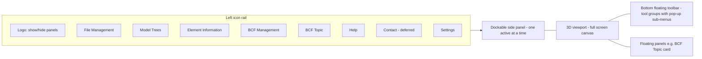

# Requirements & Problem Understanding

> Source: hands-on research of https://viewer.crais.io/ (2026-10-14) — UI walkthrough with the bundled example model (ARC + MEP + STR, 8 BCF topics), tooltip inspection, and the app's i18n string table / in-app Help panel. Requirement IDs use the prefix of their area (e.g. `MT-03`). **Scope decision (2026-10-14): Phase 1 = exact feature parity with the reference — every P0 and P1 item ships in Phase 1.** P0 = core (build first), P1 = remaining reference features (still Phase 1), P2 = not in the reference UI, deferred to later phases.

## Problem Statement

- AEC users (architects, engineers, BIM coordinators, site managers, clients) need to open, inspect and coordinate IFC models without installing desktop software (Solibri, Navisworks, BIMcollab Zoom).
- Existing desktop tools are heavy, licensed and OS-bound; many web viewers upload models to a server, which is a blocker for confidential projects.
- Coordination issues (clashes, missing items) are exchanged as **BCF** files; users need to open, create, edit and export BCF topics against the model in the same tool.

## Goals & Objectives

**Primary goals**
- Load one or several IFC models (federated) entirely client-side and render them fast in 3D.
- Navigate, select, inspect (properties / quantities / materials / relations), hide/isolate, color, measure and section the model.
- Full BCF round-trip: import `.bcf/.bcfzip`, view/create/edit topics, comments, viewpoints, pins, snapshots, export.
- Privacy by design: **no model data leaves the browser**.

**Secondary goals**
- Export the optimized model as `.frag` for fast reload.
- Light/dark theme, English-only UI, render-quality settings.
- In-app help describing every tool.

**Non-goals**
- Model authoring/editing of IFC geometry or properties.
- Server-side storage, user accounts, multi-user real-time collaboration, BCF-API (server) sync.
- Clash detection engine (clashes arrive as BCF topics).
- 2D drawing / DWG / Revit native (`.rvt`) support.

## Application Layout

- **LY-01 (P0)** Left vertical icon rail with: Show/hide panels (logo), File Management, Model Trees, Element Information, BCF Management, BCF Topic; bottom-aligned: Help, Settings (Contact deferred, see HC-02). Each icon has a hover tooltip.
- **LY-02 (P0)** Clicking a rail icon opens its panel in the left dock; clicking the active one or the logo collapses the panel to give the viewport full width.
- **LY-03 (P1)** Panels can be docked or floating (`panels.dock`); the BCF Topic panel appears as a floating card over the viewport.
- **LY-04 (P0)** Bottom-centre floating toolbar of tool groups. Each group button shows the active sub-tool icon and a `^` caret; hovering opens a vertical pop-up of sub-tools with tooltips. Active tool is highlighted. Groups are visually separated into: *interaction tools* (orange: Selection, Measurement, Clipping, BCF) | *view tools* (teal: Navigation, Camera/Projection, Color) | *Reset/Visibility*.
- **LY-06 (P1)** Right-click (without dragging) in the viewport opens a radial menu centred on the cursor: Close in the middle, four spokes (Selection ↑, Visibility/Reset →, Measurement ↓, Clipping ←) each showing the group's current tool. Hovering a spoke fans its options out in an arc (Selection: rectangle, select; Visibility: isolate | show all, hide selected, zoom to selected, zoom all, show all, reset all; Measurement: the six measure modes; Clipping: box, plane). Opens collapsed; spokes show the group's active tool, else the last used (shared with the toolbar), else the default. Hover enlarges a button slightly; no item is ever greyed out (inapplicable ones are no-ops). Clicking a spoke or fan item runs it and closes; ESC, a click on blank space or outside closes (an outside click still reaches the model). Right-click does not select; it also opens on empty background; a right-drag pans instead. *(Researched on the reference 2026-10-14.)*
- **LY-05 (P1)** Layout must remain usable down to ~1024 px width; panels scroll internally.

## Functional Requirements

### 1. Welcome / Onboarding (WL)
- **WL-01 (P0)** On first load show a modal "Free Online IFC Viewer" with: short intro, a **Load IFC models** drop zone (drag & drop or click to browse), and a **Start with a BIM example model** card.
- **WL-02 (P0)** Feature bullet list: free, rich toolset, load `.ifc` or `.frag`, privacy by design – no server uploads, import & export `.bcf`, create & edit BCF topics.
- **WL-03 (P1)** Footer links: Legal Notice, Terms of Service, Privacy Policy, LinkedIn, YouTube. Modal is closable (×).
- **WL-04 (P0)** Example model = 3 federated discipline models (`example-arc`, `example-mep`, `example-str`) plus a preloaded BCF file (8 topics) so all features can be demoed.

### 2. File Management (FM)
- **FM-01 (P0)** Load files via button, drag & drop onto the viewport or welcome modal. Accepted: `.ifc`, `.frag`. Multiple files at once → federated scene.
- **FM-02 (P0)** IFC parsing/conversion runs in a **Web Worker** (`loader.worker`, `fragment.worker`) so the UI stays responsive; show per-file loading progress/status.
- **FM-03 (P0)** File list with search box; per file: name, **Download as .frag** (optimized format for faster reload), **Unload** (remove from viewer).
- **FM-04 (P0)** **Unload all** button.
- **FM-05 (P0)** All data processed and stored locally in the browser ("Your model data stays on your device"). No network upload of model files.
- **FM-06 (P1)** Graceful error for invalid/unsupported files with a readable message.

### 3. Model Trees (MT)
Three tabs over all loaded models:
- **MT-01 (P0) Relations** – IFC spatial structure per buildingSMART: Project → Site → Building → Storey → Element; root nodes = loaded models.
- **MT-02 (P0) Types** – grouped by IFC class (IfcWall, IfcDoor, IfcSlab…).
- **MT-03 (P1) Storeys** – grouped by building storey across federated models (storey matching tolerance 1 m offset).
- **MT-04 (P0)** Search bar filters the tree by name or type; `>` button / expand-all, collapse-all, and "expand to selection" controls (`+`, `−`, `=`).
- **MT-05 (P0)** Per row: expand chevron, **color swatch** (original color, custom color shown with a ring, color wheel if several colors) — click to set/remove a custom color for all elements of the row; **eye** toggle for visibility.
- **MT-06 (P0)** Clicking a row selects its elements in 3D; **CTRL** = multi-select, **SHIFT** = range select. On a selected row the eye/color apply to the whole selection.
- **MT-07 (P0)** Header actions: Hide selected, Show selected, Isolate | Show all, Show all.
- **MT-08 (P1)** Toggles to show/hide (permanently) **openings** (IfcOpeningElement) and **spaces** (IfcSpace); spaces/openings hidden by default.
- **MT-09 (P1)** Tree loading is batched/virtualized to handle 100k+ elements.

### 4. Element Information (EI)
- **EI-01 (P0)** Shows info for the single selected element; header = IFC class (e.g. `IFCWALLSTANDARDCASE`). Empty state: "Select one element to view its information"; multi-select state: "Multiple elements selected".
- **EI-02 (P0)** Tabs:
  - **Identity** – Attributes (GlobalId, Name, ObjectType, Tag…), General, Header (source file).
  - **Properties** – all IfcPropertySet, standard & custom.
  - **Quantities** – IfcElementQuantity base & derived (length, area, volume); tab disabled when none.
  - **Relations** – IfcRel* (containment, aggregation, connections, assignments…).
  - **Materials** – IfcMaterial, layer sets, composite definitions.
- **EI-03 (P0)** Collapsible groups, search box across values, expand-all; long values truncated with full value on hover/copy.

### 5. Selection (SE)
- **SE-01 (P0) Select** (default): click to select; CTRL to add; ESC clears; double-click element = select + isolate.
- **SE-02 (P1) Selection rectangle**: click-drag box. Left→right selects elements fully inside; right→left selects elements inside or touching. One-shot: after one box the tool returns to Select.
- **SE-03 (P0)** Hover highlight; selection highlight color; selection synchronised with Model Tree and Element Information.

### 6. Navigation (NV)
- **NV-01 (P0) Orbit** (default): left mouse rotate, right/middle pan, wheel zoom.
- **NV-02 (P1) Fly / first-person** ("ideal inside a building"): hold left mouse to look; W/S or ↑/↓ forward/back, A/D or ←/→ left/right; SHIFT = faster.
- **NV-03 (P1) Drone / plan pan** ("ideal for infrastructure and large-scale projects").
- **NV-04 (P0)** Double-click in empty viewport area = zoom to fit all.

### 7. Camera / Projection (CA)
- **CA-01 (P0)** Perspective ↔ Orthographic (isometric) projection.
- **CA-02 (P1)** Top view, Bottom view.
- **CA-03 (P1)** View from plane: click a surface → camera aligns perpendicular to it.

### 8. Visibility & Reset (VI)
- **VI-01 (P0)** Zoom to all (fit visible), Zoom to selection.
- **VI-02 (P0)** Hide selected, Show selected (add from tree), Isolate selected / Show all (toggle), Show all.
- **VI-03 (P0)** **Reset all**: visibility, tool modes and camera back to default.

### 9. Color (CO)
- **CO-01 (P0) Original colors** – material colors.
- **CO-02 (P1) Paper model / White** – all elements white, custom colors stay visible.
- **CO-03 (P1) Color item** – pick a color, then click elements to paint them; picker eraser removes an element's color; ESC/close picker ends coloring; elements selected beforehand are colored immediately.
- **CO-04 (P1) Clear coloring** – remove all custom colors.
- **CO-05 (P1)** Custom colors are stored in BCF viewpoints.

### 10. Measurement (ME)
- **ME-01 (P0) Length free** – click start & end points (with snapping to vertices/edges/faces).
- **ME-02 (P0) Length edge** – click an edge to get its exact length.
- **ME-03 (P1) Area free** – click polygon points; double-click or ENTER to finish.
- **ME-04 (P1) Area rectangle**.
- **ME-05 (P1) Area face** – click a face to measure its area.
- **ME-06 (P1) Volume** – click one or several elements.
- **ME-07 (P0)** Show/hide all measurements; Delete all measurements; hover a measurement + DEL deletes it; ESC cancels an unfinished one.
- **ME-08 (P0)** Units in metric (m, m², m³) with sensible precision; labels always face camera.

### 11. Clipping / Sections (CL)
- **CL-01 (P0) Set clipping plane** – click a face to create a plane aligned to it; draggable gizmo to move it. Multiple planes allowed (hard cap **10**).
- **CL-02 (P1) Clipping box** – box around current selection (or click an element if nothing selected), with gizmos.
- **CL-03 (P0)** Toggle clipping on/off without deleting planes.
- **CL-04 (P1)** Show/hide plane helpers while keeping the model clipped.
- **CL-05 (P0)** Delete all clipping planes.
- **CL-06 (P2)** Section caps/fill on cut surfaces. **Moved to P2 (2026-10-14):** not present in the reference UI (added during research by mistake); That Open ClipStyler caps cost seconds of main-thread time per plane.

### 12. BCF Management (BM)
- **BM-01 (P0)** Toolbar: **Import** (drag & drop or browse `.bcf/.bcfzip`, BCF 2.1 / 3.0), **Export/Download** (all or selected → `.bcfzip`), **New topic**, **Delete** (all or selected, with confirmation), **Author** (name/email recorded on topics & comments, optionally remembered).
- **BM-08 (P0)** BCF version support: **import** detects the version from `bcf.version` `VersionId` (2.x → 2.1 parser, 3.x → 3.0 parser; missing VersionId → error per BM-07). **Export** can write BCF **2.1** or **3.0**, chosen by the user at download, default 3.0. One shared internal topic model maps to and from both XML schemas (e.g. 2.1 `markup.bcf` per-topic `Header`/`Viewpoints` ↔ 3.0 `documents.xml`/`extensions.xml`, renamed fields). Round-trip 2.1→app→2.1 and 3.0→app→3.0 must keep all data; 2.1↔3.0 conversion may drop only fields the target schema lacks.
- **BM-02 (P0)** Topic table with checkbox selection, thumbnail column (snapshot), Title; footer topic count ("8 topics" / filtered count).
- **BM-03 (P1)** Column settings: show/hide columns — Thumbnail, Title, Type, Status, Priority, Stage, Labels, Assignee, Due, Created, Created by, Modified, Modified by, Description.
- **BM-04 (P1)** Filterable columns; active filters displayed above the table; free-text search. Filters/search also hide the pins of filtered-out topics.
- **BM-05 (P0)** Clicking a topic opens it in the BCF Topic panel and restores its viewpoint (camera, visibility, selection, colors, clipping).
- **BM-06 (P1) Pin settings**: show/hide topic pins in the model, color pins by a field (e.g. status/priority/type), select by pin.
- **BM-07 (P0)** Import errors shown with a clear heading/message (e.g. invalid zip, missing `bcf.version`).

### 13. BCF Topic (BT)
- **BT-01 (P0)** Topic form: Title*, Description, Assignee, Due date (date picker), Status*, Priority, Type*, Stage, Labels (multi, add/remove options). View mode → **Edit** / **Delete**.
- **BT-02 (P0)** **Comments & viewpoints** list: author + timestamp, text, optional snapshot/viewpoint; add comment (confirm with send button).
- **BT-03 (P0)** Capture viewpoint = current camera + snapshot image (+ visibility/colors/clipping/selection).
- **BT-04 (P1)** Place a **pin** in the model marking the viewpoint (ESC cancels); pins numbered in model and on snapshots; click pin in model → open topic.
- **BT-05 (P1)** Snapshot actions: enlarge, download, refresh from current view, add/replace from PNG/JPG file (invalid image rejected), **sketch** mode (draw on image).
- **BT-06 (P1)** Click a snapshot to restore its viewpoint (captured viewpoints only).
- **BT-07 (P0)** Edit session: comments added in the session can be edited/removed until **Save**; **Cancel** prompts "Unsaved changes will be lost" (Discard / Keep editing). Switching topic or deselecting while dirty asks for confirmation.
- **BT-08 (P1)** Toolbar shortcut **New BCF topic + pin** and toolbar toggle for pins visibility.

### 14. Settings (ST)
- **ST-01 (P1)** Light/Dark mode toggle.
- **ST-02 (P2)** UI is **English only** (decided 2026-10-14) — no language selector in Phase 1. This is a deliberate deviation from the reference (EN/DE). Keep UI strings in one module so a selector can be added later.
- **ST-03 (P1)** Model appearance ("turn off to improve performance"): Outlines (on by default), Depth shadows / ambient occlusion, Antialiasing, Fix missing faces (double-sided rendering).
- **ST-04 (P2)** **Deferred (decided 2026-10-14): no analytics in Phase 1, so no cookie banner or cookie settings.** Add when analytics are introduced: necessary cookies always; analytics only after consent, anonymised.
- **ST-05 (P2)** Persist settings in `localStorage`.

### 15. Help & Contact (HC)
- **HC-01 (P1)** Help panel: accordion per area (File Management, Model Trees, Element Information, BCF Management, BCF Topic, Navigation, Camera, Color, Visibility, Selection, Measurement, Clipping, Settings), each with a description and item list (icon + label + how-to, incl. keyboard shortcuts).
- **HC-02 (P2)** **Deferred (decided 2026-10-14) — not in Phase 1; the Contact rail icon is omitted until then.** Contact panel: email, website, LinkedIn; message form (Name*, Email*, Subject* [Bug report, Feature request, Feedback, Partnership, Other → custom subject], Message*, privacy-consent checkbox*), validation messages and success/error states.
- **HC-03 (P2)** Minimap / infra-section viewports (present in reference code as `tools.viewport.*`, not exposed in UI) — out of MVP.

### Keyboard & Mouse Summary

| Input | Action |
|---|---|
| Left click | Select element / activate tool point |
| CTRL + click | Add to selection |
| SHIFT + click (tree) | Range select |
| Double-click element | Select & isolate |
| Double-click empty space | Zoom to all |
| ESC | Clear selection / cancel measurement, pin placement, coloring |
| DEL (hover measurement) | Delete that measurement |
| ENTER / double-click | Finish area polygon |
| Left drag / right-middle drag / wheel | Orbit / pan / zoom |
| W A S D / arrows, SHIFT | Fly mode movement, faster |

## User Stories & Use Cases

- As a **BIM coordinator**, I load ARC, STR and MEP IFCs together, import the clash BCF from the coordination tool, click each topic to jump to its viewpoint, add a comment with a new snapshot and export the updated `.bcfzip`.
- As an **architect**, I isolate a storey from the Storeys tree, section it with a clipping box and measure room areas.
- As a **site manager**, I select a wall and read its fire rating and material layers in Element Information.
- As a **client** with confidential data, I open the model knowing nothing is uploaded.
- As a **repeat user**, I download the `.frag` once and reopen it much faster next time.

**Edge cases**
- Very large IFC (> 500 MB, > 1 M elements) — progress, memory limits, worker crash recovery.
- IFC2x3 vs IFC4 / IFC4.3 schemas; models with missing faces or no storeys.
- BCF referencing GUIDs not present in the loaded models; BCF without snapshots; BCF 2.1 vs 3.0.
- Federated models with different georeferencing / offsets.
- Unsaved BCF edits when switching topic, closing panel or unloading models.
- 11th clipping plane (cap reached) → user-visible message.

## Success Criteria

- All **P0 and P1** requirements (exact reference parity) implemented and passing acceptance tests on Chrome, Edge, Firefox, Safari (latest 2 versions).
- Example model (3 models) loads to first render in **< 5 s** on a mid-range laptop; `.frag` reload ≥ 3× faster than IFC.
- Viewport ≥ **30 FPS** orbiting a 200 MB federated model with outlines on.
- Network inspection during load/use shows **zero** requests containing model or BCF data.
- BCF exported by the app re-imports losslessly in the app and opens in at least one third-party tool (e.g. BIMcollab Zoom / Solibri).
- Every toolbar and rail item has a tooltip and a Help entry.

## Constraints & Assumptions

- **Tech (observed in reference):** React SPA built with Vite/Rolldown, **three.js** renderer, That Open Engine–style **Fragments** format (`.frag`) with IFC parsing (web-ifc/WASM) in Web Workers; i18n key-based strings (EN/DE).
- Client-only; static hosting is sufficient. No backend in Phase 1 (contact form deferred; analytics optional).
- WebGL2 required; no mobile-first support (desktop target).
- Assumption: we reuse open-source building blocks (three.js, `@thatopen/components` / `@thatopen/fragments`, web-ifc) rather than writing an IFC parser.
- Licensing: verify licences of chosen libs (web-ifc MPL-2.0, That Open MIT) and don't copy crais branding, copy or assets.

## Questions & Open Items

1. ~~Exact clone or subset?~~ **Decided:** exact feature parity first (all P0 + P1); P2 items later.
2. ~~Required BCF versions?~~ **Decided:** read and write both BCF 2.1 and 3.0 (see BM-08).
3. Is a backend (accounts, cloud projects, BCF-API sync) planned later? Affects state design.
4. ~~Languages?~~ **Decided:** English only; the language selector is deferred (ST-02).
5. Branding/name and analytics provider. (Contact-form backend: N/A until HC-02 is picked up.)
6. Is mobile/tablet touch navigation required?
7. Should minimap / infrastructure section views (hidden in reference) be in scope?
